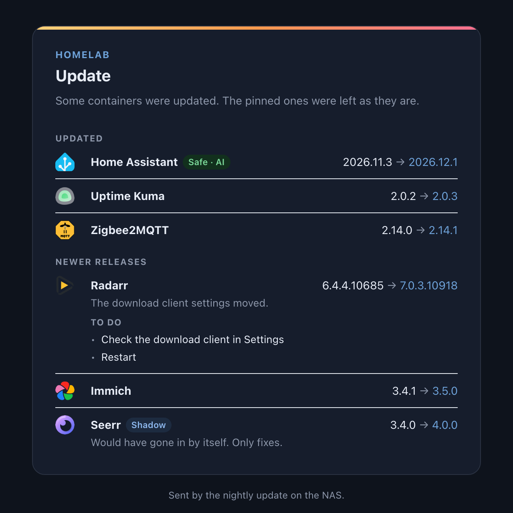
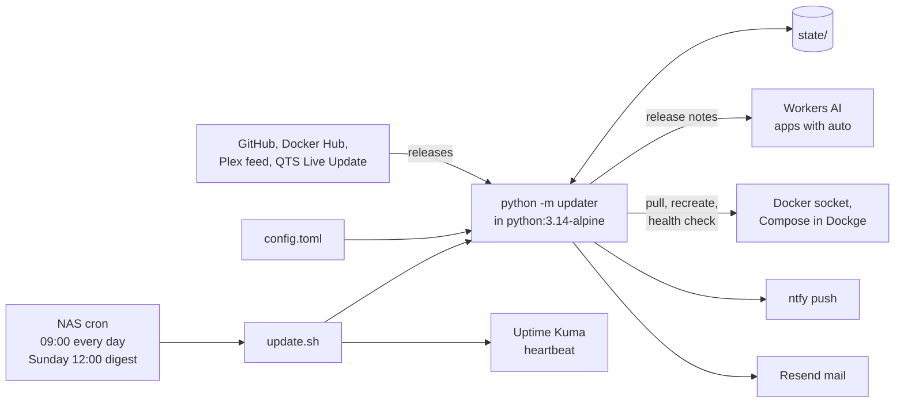

# Container updates

`update.sh` runs once a morning. It looks at what is actually running, bumps the apps `config.toml` lists, and sends mail only when something new happened. It does not run all day, and it does not update every stack.

<p align="center"></p>
<p align="center"><sub>The Sunday mail, rendered from <code>updater/mail.py</code> with sample data.</sub></p>

## How it fits



Each morning the run reads `config.toml`, checks what is running against the releases, and moves each app as its policy says, one app at a time. What it did is pushed to ntfy that morning and mailed on Sunday; what needs a hand is pushed once and mailed. `update.sh` then tells Uptime Kuma whether the run went through.

## Policies

| Policy | What it does | Apps |
| --- | --- | --- |
| `floating` | Pulls the tag the containers run and recreates them if the image changed. A release past the tag is mailed, or judged by Workers AI where the app has `auto`. | Home Assistant, Homer, Zigbee2MQTT, Mosquitto, Traefik, Uptime Kuma, Beszel, Dockge, Maintainerr, Seerr, Radarr, Sonarr, Prowlarr, qBittorrent, Cloudflared |
| `semver` | Follows the GitHub releases: a patch that morning, a minor too (after `wait_days` where set, never with `pin_minor`), a major only mailed. | Immich, AdGuard Home |
| `report` | Never bumped. A newer release is pushed once and mailed on Sunday. | OpenCloud, Plex, QTS |

A recreate that fails or does not become healthy is rolled back, except Immich's, whose database may already have migrated.

## Docs

- [What each run does](docs/policies.md): the policies, their fields, and which app gets which.
- [When an update fails](docs/failures.md): retries, health checks, rollback, and what is remembered.
- [By itself (`auto`)](docs/auto.md): what Workers AI is shown, how it decides, and how a release goes in.
- [Prune, mail, push and heartbeat](docs/notifications.md): what is sent, when, and the settings in `.env`.

## Install

Installed in the NAS crontab. Updates run at 09:00, NAS time, after the QNAP jobs at 03:00 and 04:00. The weekly mail and the image prune run at noon on Sunday. Output goes to `updates/state/cron.log`, so `updates/state/` must exist before cron runs. Past 2 MB the log is cut to its last 5000 lines.

```
0 9 * * * /share/CACHEDEV2_DATA/SSDShared/updates/update.sh >> /share/CACHEDEV2_DATA/SSDShared/updates/state/cron.log 2>&1
0 12 * * 0 /share/CACHEDEV2_DATA/SSDShared/updates/update.sh --digest >> /share/CACHEDEV2_DATA/SSDShared/updates/state/cron.log 2>&1
```

## Layout

The stacks directory is the parent of this folder. Nothing in the Python is pinned to a machine path. What you edit and run sits at the top; the code is the `updater/` package, which `update.sh` runs as `python -m updater`.

| Path | Role |
| --- | --- |
| `update.sh` | Starts the run. Under cron (root) it runs `python:3.14-alpine` as the owner of this script, with the Docker socket and the stacks directory mounted. Then sends the heartbeat. |
| `config.toml` | The apps, their policy, releases and version sources, and the compose container. |
| `icons/` | One `<key>.png` per app, for the mail and the push. The push links them on GitHub, so they stay at this path. |
| `state/` | What the runs remember, the log and the rollback copies. Gitignored. |
| `docs/` | The details behind this page, and the sample mail in `docs/images/`. |
| `updater/config.py` | Reads `config.toml`, and refuses anything it does not understand. |
| `updater/main.py` | Lock, mail timing, weekly state, prune. `--dry-run`, `--check`, `--notify-only`, `--digest`. |
| `updater/jobs.py` | One path per policy: what is bumped, mailed, or left alone, and the moves `auto` makes. |
| `updater/auto.py` | What Workers AI is asked about a release, the checks that can only say no, the rollback copies and the commit. |
| `updater/verdict.py` | The Workers AI request and its answer. |
| `updater/notes.py` | Release notes and the pages they link, trimmed to breaking changes. |
| `updater/composefile.py` | A compose file's image line changed with nothing else touched. |
| `updater/releases.py` | Version rules, GitHub, Docker Hub, the Plex download feed, and QTS Live Update. |
| `updater/mail.py` | The card mail. |
| `updater/push.py` | The ntfy push for each update and each release to install by hand. |
| `updater/runtime.py` | Docker over the socket, API 1.41 or the daemon's minimum if that is newer. Compose runs inside the compose container, with the files from the container labels. |
| `tests/` | One file per module above, and `support.py` with the fake Docker and the shared fixtures. No Docker. |

To add an app, add a table to `config.toml` and an icon as `icons/<key>.png`, then check with `--dry-run`.

```
updates/update.sh --dry-run      decide only
updates/update.sh --check        confirm the compose container can run Compose, and list what a new
                                 patch, minor and major does to each app
updates/update.sh --digest       Sunday mail and prune, no updates
updates/update.sh --notify-only  mail new releases now, bump nothing
```

`python3 -m unittest discover -s tests -t .`, from this folder, runs the tests on a machine that has Python. CI runs them on every push.
