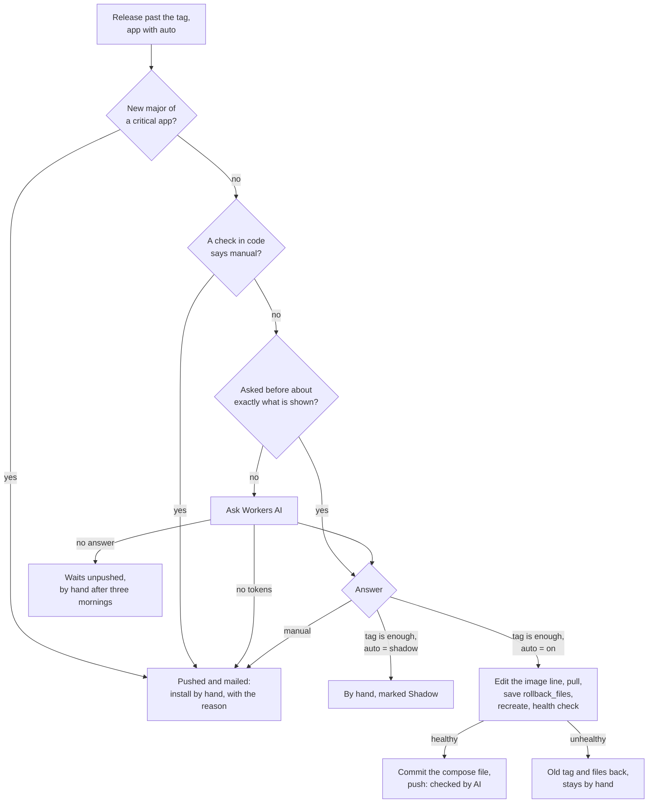

# By itself (`auto`)

Part of [Container updates](../README.md).

Most releases left to a hand need nothing but the new tag. With `auto` set on an app, Workers AI reads the release notes and says whether that is so. It decides one thing only: whether the tag change is all it takes on this setup. Everything else, a file to edit, a command to run, a setting to change, stays by hand, and the push and the mail say why and what to do. When it is held because breaking changes were found, the push says who found them: "Breaking changes detected by AI." or, when a check in code did (below), "Breaking changes detected in the notes." The push gives the first reason and every step; the mail gives every reason.

It applies to the releases the run would otherwise leave to a hand: the newest release past a floating tag (`2026.11` to `2026.12`, `v3` to `v4`), a major that `hold_major` keeps back, and a semver major or `pin_minor` minor. A release a semver app installs by itself anyway is not asked about. A new major is asked about too, except for an app with `critical = true`, whose majors stay by hand, unasked: Immich, Traefik and AdGuard Home. Home Assistant is pinned to its exact version (`2026.11.3`), so every release is past its tag: a patch (`2026.11.4`) and a new month (`2026.12.0`) alike, and the tag moves to the exact new version. A release the tag takes by itself is asked about only with `breaking_marker`: then it goes in by itself unless a line of its notes carries the marker and names something in the inventory, or nothing (the app itself), and is held for Workers AI if so. No app ships with it.

- **When.** A release is asked about the first morning the run sees it, and with `auto = "on"` it goes in that same run. An app with `wait_days` is asked once the first release of the new line (`2026.12.0` for `2026.12`, `4.0.0` for `v4`) is that many days old; until then it is a **Newer releases** row that is not pushed, nor marked as mailed, so its verdict is pushed when it comes.
- **What it is shown.** The notes of every release after the running one up to the new one, each after the notes of its betas, trimmed to their breaking changes, deprecations, removals, migrations and changed settings, each kept line under its heading. With `linked_notes`, also the pages a stable release's notes link as release notes, a migration guide or breaking changes, a link or a bare URL on such a line or alone in the notes (Home Assistant's blog post, Uptime Kuma's migration guide), only the linked section when the link names one, and cut at 60,000 characters (a discussion page carries every comment). Then what the updater does by itself (the tag, the pull, the `rollback_files` it saves, the health check and rollback), so none of it is listed as a step for you; the app's compose service as written but without its comments, whole-line or trailing, which describe the routine by hand (values from `.env` are never read, override files are left out); the names in `inventory_file` (for Home Assistant, the domain of each integration set up; for Zigbee2MQTT, the model of each paired device; nothing else of those files); and the `context_files` (Home Assistant's `configuration.yaml`, automations and scripts, so a change to a trigger can be checked against the ones written), with the value of any key named like `webhook_id`, `token`, `password`, `secret` or `api_key` shown as `(hidden)`. Never a file with secrets: everything shown goes to Cloudflare.
- **How it decides.** Most releases need nothing but the image, and an unhealthy start is rolled back anyway, so it says manual only for a step, or a breaking change, removal, rename or changed default, that applies to something it can see this setup uses, or a step the notes ask of everyone. A change for a feature, integration or device that is not in what it is shown is not a reason, and neither is general advice such as backing up. Missing or cut notes are.
- **Code can only say no, and then nothing is asked.** Checks in code say "manual" when the notes name something in the inventory or an environment key or flag the compose service sets, or say a change can't be undone, or when a page they link was cut, and so do notes that are missing, too long, or may skip a release. Workers AI is asked only when none of them does, since its answer could not change the decision; the push then gives the check's reason. Code never says "auto".
- **Asked once, for what it was shown.** The answer stays in `state/verdicts.tsv`, with a fingerprint of everything Workers AI was shown. Each morning the question is put together again, and if the notes, the compose service, the inventory, the files or the model changed, it is asked again; otherwise the answer stands. A release rolled back after it went in by itself stays by hand whatever is shown later.
- **No answer yet.** When Workers AI can't be reached, or the question can't be put together, the release waits for an answer: a **Newer releases** row saying so, not pushed and not marked as mailed, asked again the next morning. After three mornings with no answer it is pushed and mailed as one to install by hand, and still asked each morning; when the answer comes, it is pushed once more with it. `state/asking.tsv` keeps the first of those mornings. The Sunday mail and `--notify-only` never ask, so a release they have no answer for waits for the next morning; `--dry-run` asks and keeps nothing but the journal line.
- **No tokens.** When Workers AI answers that the day's free allocation is used up (HTTP 429, or error 4006) or refuses the token (401, 403), or `.env` has no Cloudflare settings, nothing more is asked that run, and each release it would have been asked about is pushed and mailed at once as one to install by hand, as without `auto`, with "Workers AI was not asked: it has no tokens left today (HTTP 429)." or the reason. It is asked again the next morning: it goes in by itself then if the answer allows it, and otherwise the answer is pushed once more, even if the Sunday mail listed the release meanwhile.
- **The journal.** Every question goes in `state/workers-ai/<year>-<month>.jsonl`, one JSON line each: the app, the running and new versions, the model, the messages exactly as sent, the checks that said "manual", the answer as it came back, and the decision, or the error. A release a check decided is written too, with the messages it would have been sent and `"asked": false`, so a check can be weighed against Workers AI later. A question is written once: a morning that reuses the answer adds nothing. The journal holds the files shown, such as the automations, so the folder is mode 700 and each file 600. It keeps the current month and the twelve before it.

`auto = "shadow"` only reports. A release that could have gone in by itself is still pushed and mailed as one to install by hand, with "Shadow mode: it would have gone in by itself" and the reasons, so the verdicts can be checked against what the release really needed before any of them acts.

`auto = "on"` installs it in the run that gets the answer:

1. The compose file's `image:` line is changed to the new tag, keeping its quotes and comments. The project as Compose resolves it, before and after, must differ in that image only, or the file is put back. The file must set the image plainly (no `${VAR}`, no digest), be writable by the updater, and be exactly as committed, since the commit takes the whole file; otherwise the release stays by hand that morning, unasked, and the reason is in the push and the mail. Once the file is committed, the next morning tries again.
2. The new image is pulled. A semver app pulls the exact version and tags it as the new tag.
3. With `rollback_files`, the `alpine/git` image a rollback uses is pulled if the Sunday prune removed it (if it can't be, nothing is stopped), then the container is stopped and they are copied to `state/rollback/<key>/`, streamed, so a database is copied whole and still. The copy stays until the next one. It holds keys and tokens (Traefik's `acme.json`, the Zigbee network key), so `state/rollback/` is mode 700 and each copy 600.
4. The containers are recreated and must become healthy. If not, the old tag goes back in the file, the containers are created without starting, the saved files are put back (each path cleared first, so files the new version added go too), and they start. The failure is mailed, and that release stays by hand from then on. A run stopped from step 3 on (a shutdown) puts the previous version back the same way before it exits.
5. The edited file is committed in the stacks checkout, from a one-shot `alpine/git` container (pinned by digest, no network) as the owner of this script. Only that file is committed. Nothing is pushed.

It is pushed like any update, saying Workers AI checked it, and the mail marks it with a green **Safe · AI** tag; what Workers AI said is in the journal.

Workers AI runs `@cf/openai/gpt-oss-120b` (`CLOUDFLARE_AI_MODEL` to change it), on Cloudflare's free tier, which keeps no prompts. One question costs a few hundred to a few thousand of the 10,000 Neurons a day. Put `CLOUDFLARE_ACCOUNT_ID` and an API token with only **Account › Workers AI › Read** on your account (`CLOUDFLARE_AI_TOKEN`; running a model needs nothing more, and the template's Edit only manages fine-tunes), in `updates/.env`. Without them, nothing is asked and every release stays by hand, as before, its push saying that Workers AI was not asked.
