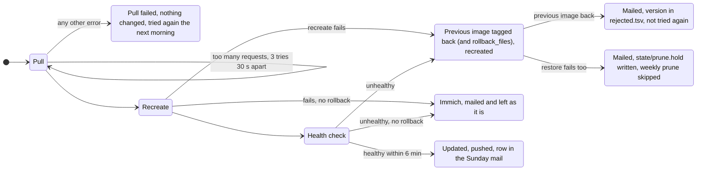

# When an update fails

Part of [Container updates](../README.md).

Every failure is written to `state/cron.log` with its error, as well as mailed. A pull the registry answers with "too many requests" is tried three times, 30 seconds apart, before it counts as failed. Any other pull error fails at once. A failed pull changes no container, and nothing remembers it: the next morning tries the same release again.

Healthy means its healthcheck passes within 6 minutes. A container without one must stay up for three checks 15 seconds apart. A container that restarts while it is checked is not healthy.

If a recreate fails or the container does not become healthy, the previous image is tagged back and the container is recreated. That failure is mailed that morning. The image that failed is written to `state/rejected.tsv` and is not tried again; the next new image is. Delete its line to try it again.

If restoring the previous image also fails, `state/prune.hold` is written and the weekly prune is skipped, so the previous image stays on disk. Each skipped prune is mailed the next morning as a reminder. Delete the file once the container is fixed.

Immich, a `semver` app without `rollback`, is never rolled back, because the new server may already have migrated its database. A failed or unhealthy Immich update is mailed and left as it is. An unhealthy one still runs the new version, so it is also an **Updated** row in the Sunday mail. A version whose recreate failed is written to `state/rejected.tsv` and not tried again.

AdGuard Home is LAN DNS, so it has `rollback = true`, and `pin_minor = true`, because since v1.0 its minors may break things. Before the update, `rollback_files` (its `AdGuardHome.yaml`) are copied out of the container, with their owner and mode. If the new version fails to start or is not healthy, `:v1` is tagged back to the previous image, the container is created without starting, the saved config is put back over the one the new version may have migrated, and only then does it start. The failure is mailed, and the version goes to `state/rejected.tsv` like a floating image. If the config cannot be copied out, nothing is updated. Its healthcheck asks AdGuard for a name its `*.PUBLIC_ZONE` rewrite answers, on its LAN address, so healthy means DNS answers, and an update that breaks DNS is rolled back within about two minutes.
