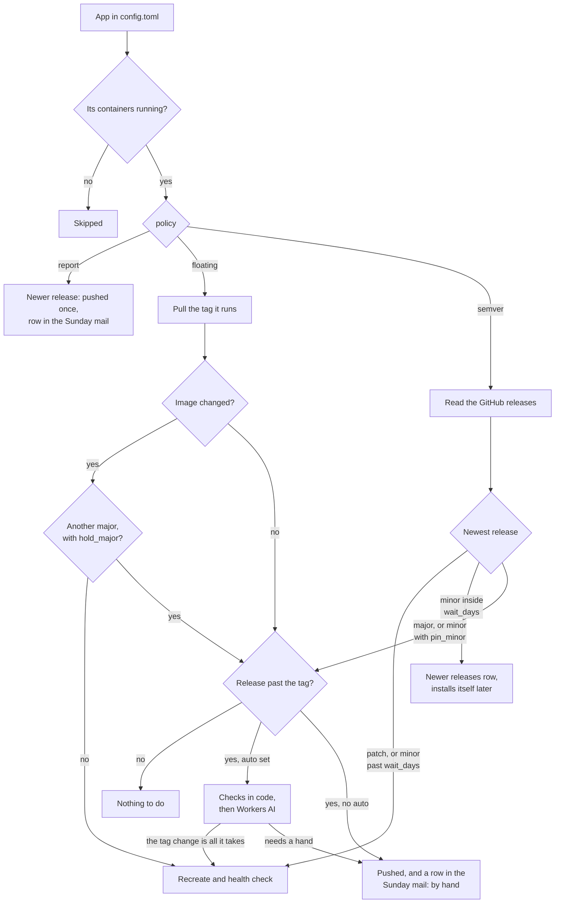

# What each run does

Part of [Container updates](../README.md).

Floating and semver apps need all their containers running, and they move together; a report app needs only its first. [When an update fails](failures.md) covers what follows a recreate, and [By itself](auto.md) what Workers AI is asked.

`config.toml` lists the apps, one `[apps.<key>]` table each, and each app has a policy. Its header explains every field. A container in no app is left alone.

| Policy | Action | Today |
| --- | --- | --- |
| `floating` | Pull the tag the containers run and recreate only if the image changed. The tag is how far it moves: a minor tag (`v3.7`) takes patches, a major tag (`2`) minors too, `latest` everything. The newest release past the tag is a **Newer releases** row in the Sunday mail, moved to by hand by changing the tag. With `hold_major = true`, for images with no major tag, a pulled image whose version label is another major gets the old image's tag back and is a **Newer releases** row instead. With `image`, any other tag is reported and left alone. | The exact version, every release judged by Workers AI: Home Assistant (`2026.11.3`), Homer (`v26.11.4`). Patches only: Zigbee2MQTT (`2.14`). Within a major: Mosquitto (`2`, `variant = "-alpine"`), Traefik (`v3`), Uptime Kuma (`2`), Beszel and its agent (`0`), Dockge (`1`), Maintainerr (`3`), Seerr (`v3`); Radarr, Sonarr, Prowlarr and qBittorrent (`latest` with `hold_major`). Everything: Cloudflared (`latest`, calendar versions) |
| `semver` | Follows the GitHub releases. A patch is taken that morning. A new minor is taken that morning too, unless the app sets `wait_days`: then its `.0` waits that many days, and a patch of that minor meanwhile is taken that morning. Immich has `wait_days = 7`. The exact tag is pulled and retagged as the tag the containers run (`:v3`), then Compose starts it with `--pull never`. Another major is never taken; it is a **Newer releases** row. With `pin_minor = true` only patches are; a newer minor is a **Newer releases** row too. Not rolled back unless `rollback = true`. | Immich server and machine learning (`:v3`, no rollback); AdGuard Home (`:v1.0`, a local tag because AdGuard publishes no minor tag, patches only, rolled back) |
| `report` | Never bumped. A newer release is included once, in the Sunday mail. | OpenCloud (its upgrade is a procedure, see `opencloud/AGENTS.md`), Plex, QTS |

The services the house or the network stops without (AdGuard Home, Zigbee2MQTT) take patches only: their minors may carry breaking changes, so those are read and moved to by hand, or judged by Workers AI where the app has `auto`. Home Assistant has calendar versions, where a patch can break things as well as a new month, so it is pinned to its exact version and Workers AI decides on every release. Mosquitto takes 2.x minors: it has no notes to judge, releases a minor every few years, and a new major, mailed, is where its defaults changed last (2.0). Traefik carries all ingress but takes v3 minors: its behaviour changes ship in patches as often as in minors, so a minor tag would add work without avoiding them. The rest take everything but a new major.

`critical = true` is on Immich, Traefik and AdGuard Home: their new majors are always installed by hand, never asked about, even with `auto`. `update.sh --check` lists what a new patch, minor and major does to each app, and fails if a critical app's tag would take a major by itself.

`members` are the other containers of an app, such as Immich's Postgres and Valkey or OpenCloud's Collabora and Yjs. They are only named in the log.

Plex is the QNAP package, not a container (`releases = "plex"`). The script reads the version from Plex on `127.0.0.1:32400` and compares it with the public QNAP build. It never installs the package.

QTS is the NAS firmware (`releases = "qts"`). The script reads the running version, build counter and build date with `getcfg`, and the model and Live Update feed from `/etc/config/uLinux.conf`, the same feed QTS itself checks. A newer version, or a rebuild of the same one, goes in the Sunday mail with its release notes. A model missing from the feed counts as a failed check. It never installs firmware.

A floating or semver app is skipped unless all its containers are running, and they move together. A report app only needs its first container running.

Compose runs inside `compose_container` (Dockge), with the project, service and every file Compose put on the containers' labels, so an override file such as Immich's is never dropped. A container that Compose did not start is reported and left alone. The compose container's own app is recreated last, from a one-shot container.

If `config.toml` cannot be read or has a mistake, nothing runs. The error is mailed like a failed update, and the run exits 1, so the heartbeat goes down.

An error in one container is reported and the run goes on with the next. If the run is stopped midway, what already moved is kept for the Sunday mail.

A release check that fails (GitHub, Docker Hub, the Plex feed or QTS Live Update) is only logged, unless it fails three mornings in a row; then it is mailed once.
